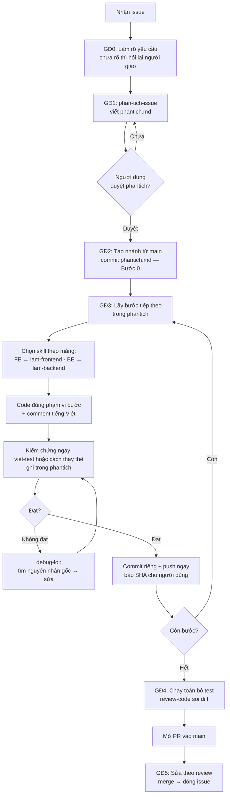

# Sơ đồ quy trình xử lý issue (đi kèm skill quy-trinh-issue)

**Cách đọc:** vòng lặp ở giữa (code → kiểm chứng → debug nếu chưa đạt → commit) là trái tim của quy trình. Mũi tên "Chưa duyệt" quay lại bước phân tích và vòng "Không đạt" quay lại bước kiểm chứng là hai vòng lặp bắt buộc — không có đường tắt đi xuyên qua chúng.
