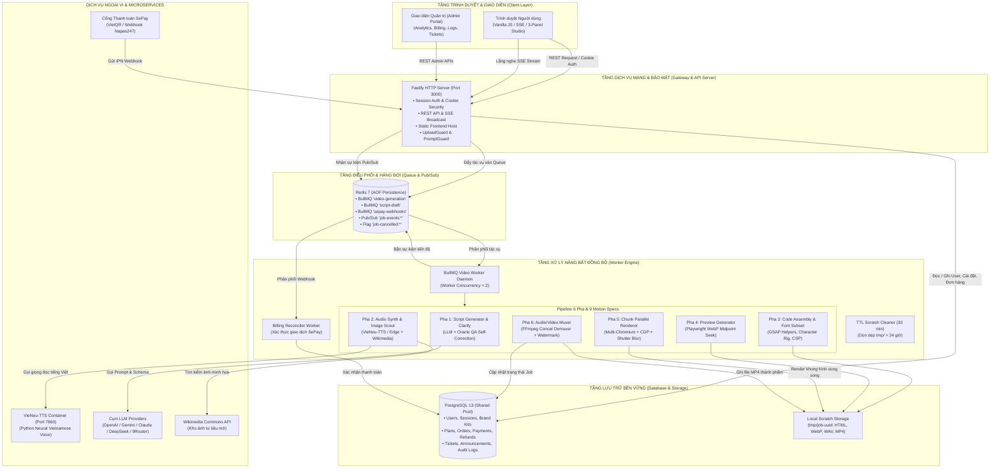
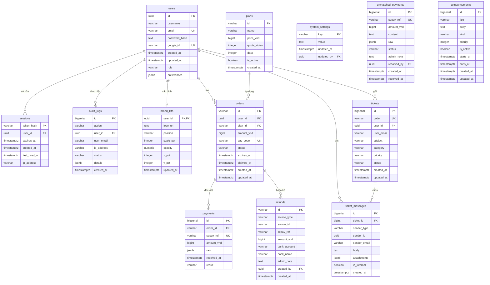
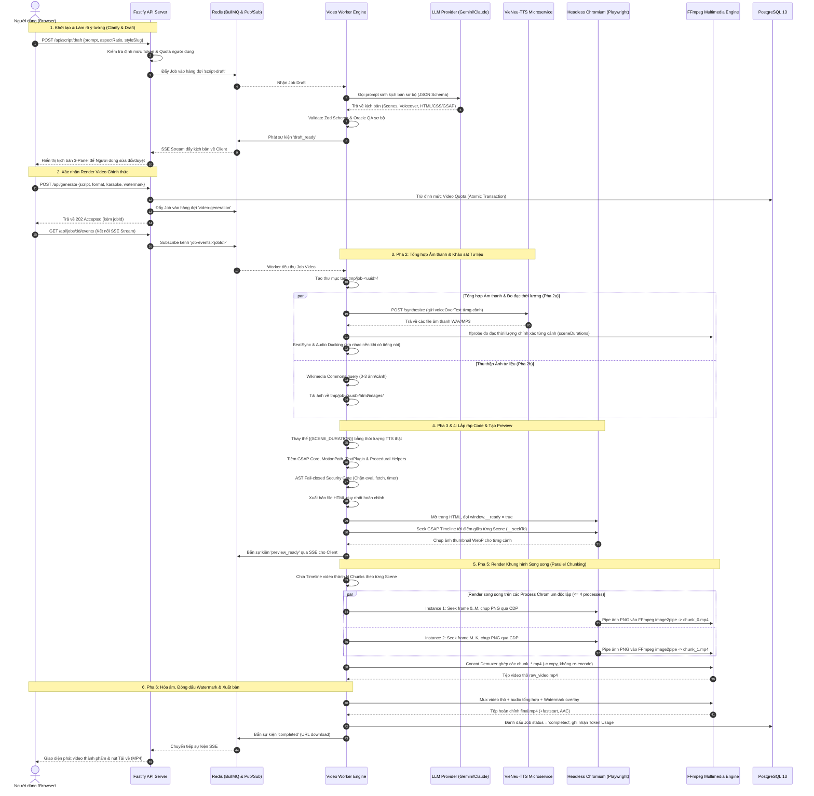
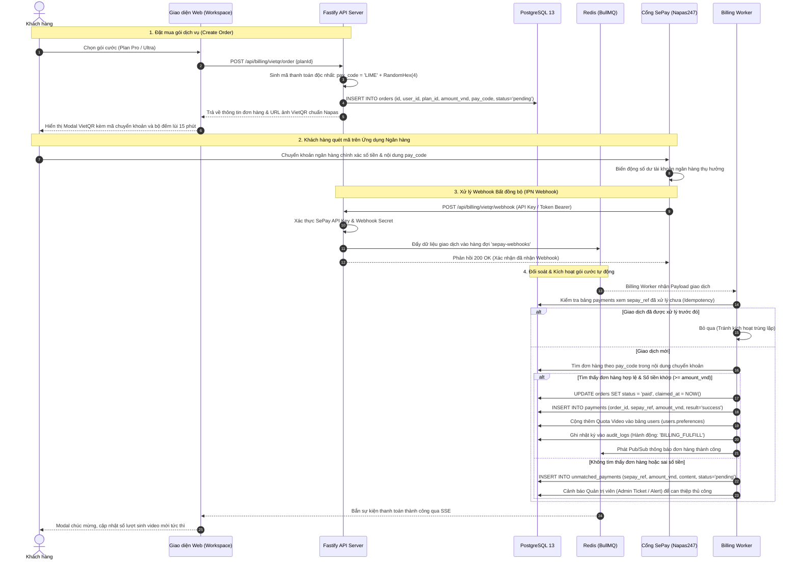
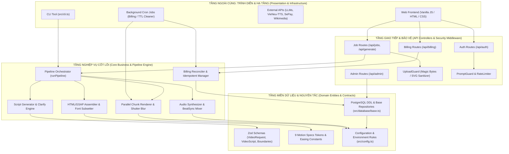
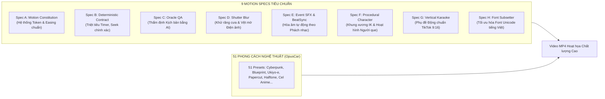
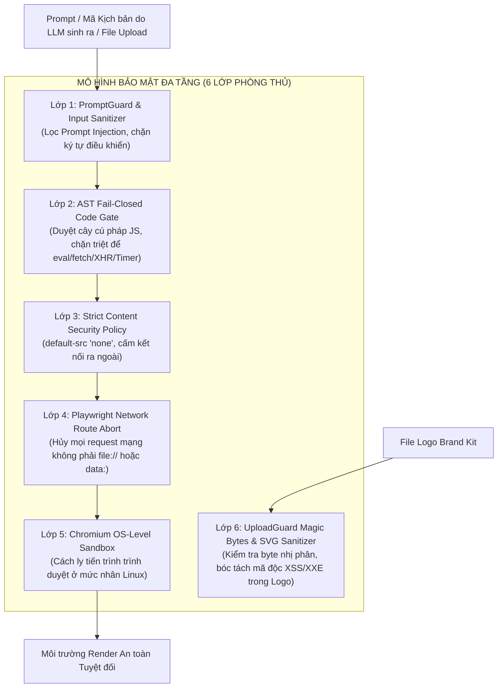
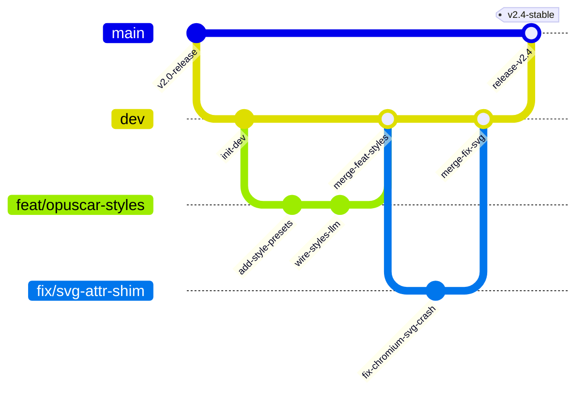
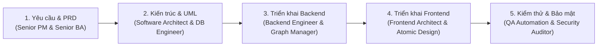

# LIME — BẢN ĐỒ TOÀN CẢNH HỆ THỐNG VÀ MÃ NGUỒN (SYSTEM & CODEBASE MASTER ARCHITECTURE MAP)

> **Dự án**: LIME (Lightweight Intelligent Motion Engine / html-to-vid)  
> **Phiên bản kiến trúc**: v2.4 (Hỗ trợ 9 Motion Specs, 51 Aesthetic Style Presets, VieNeu-TTS, VietQR Billing & Multi-process Chunk Parallel Rendering)  
> **Tài liệu quy chuẩn**: Bám sát tiêu chuẩn thẩm định kỹ thuật, quy trình Vibe Coding chuẩn 5 bước và hướng dẫn bảo vệ đề tài.

---

## MỤC LỤC TỔNG QUAN

1. [Tổng quan Đề tài & Phạm vi Nghiên cứu (Project Scope & Objectives)](#1-tổng-quan-đề-tài--phạm-vi-nghiên-cứu)
2. [Hệ thống Biểu đồ UML Chuẩn hóa (Mermaid Diagrams)](#2-hệ-thống-biểu-đồ-uml-chuẩn-hóa)
   - 2.1. [Sơ đồ Kiến trúc Tổng thể Hệ thống (System Architecture)](#21-sơ-đồ-kiến-trúc-tổng-thể-hệ-thống)
   - 2.2. [Mô hình Cơ sở Dữ liệu Thực thể Quan hệ (Database ERD - 13 Tables)](#22-mô-hình-cơ-sở-dữ-liệu-thực-thể-quan-hệ-erd)
   - 2.3. [Sơ đồ Tuần tự Pipeline Sinh Video 6 Pha (Video Generation Lifecycle)](#23-sơ-đồ-tuần-tự-pipeline-sinh-video-6-pha)
   - 2.4. [Sơ đồ Tuần tự Thanh toán VietQR & SePay Webhook (Billing Flow)](#24-sơ-đồ-tuần-tự-thanh-toán-vietqr--sepay-webhook)
   - 2.5. [Sơ đồ Kiến trúc Phân tầng & Luồng Phụ thuộc (Clean Architecture & Dependency Flow)](#25-sơ-đồ-kiến-trúc-phân-tầng--luồng-phụ-thuộc)
3. [Bản đồ Cấu trúc Thư mục & Modules Mã nguồn (Codebase Directory Map)](#3-bản-đồ-cấu-trúc-thư-mục--modules-mã-nguồn)
4. [Đặc tả Kỹ thuật 9 Motion Specs & 51 Aesthetic Style Presets](#4-đặc-tả-kỹ-thuật-9-motion-specs--51-style-presets)
5. [Mô hình Bảo mật Đa tầng (Defense-in-Depth Security Model)](#5-mô-hình-bảo-mật-đa-tầng)
6. [Quy trình Quản trị Mã nguồn Git & CI/CD (Git Workflow & Quality Gates)](#6-quy-trình-quản-trị-mã-nguồn-git--cicd)
7. [Ma trận Kỹ năng & Vai trò AI Agents (AI Roles & Skills Matrix)](#7-ma-trận-kỹ-năng--vai-trò-ai-agents)
8. [Sổ tay Lệnh Vận hành, Cấu hình & Kiểm thử (Operations & Testing Guide)](#8-sổ-tay-lệnh-vận-hành-cấu-hình--kiểm-thử)
9. [Kịch bản Báo cáo, Demo Trực tiếp & Bộ Câu hỏi Phản biện (Defense & Live Demo Guide)](#9-kịch-bản-báo-cáo-demo-trực-tiếp--bộ-câu-hỏi-phản-biện)

---

## 1. TỔNG QUAN ĐỀ TÀI & PHẠM VI NGHIÊN CỨU

### 1.1. Tính thực tiễn và cấp thiết
* **Thực trạng**: Việc sản xuất video giải thích ngắn (Shorts, Reels, TikTok, Explainer Video) truyền thống đòi hỏi chi phí phần mềm đồ họa đắt đỏ (After Effects, Premiere), thời gian dàn dựng thủ công (hàng giờ cho 1 phút video), và bắt buộc phải sở hữu dàn máy tính gắn GPU hiệu năng cao để render các hoạt cảnh 3D/Motion Graphics.
* **Giải pháp LIME**: Đột phá bằng phương pháp **DOM Seek-based Headless Video Generation**. Thay vì render bằng engine 3D đồ sộ ngốn GPU, LIME biến prompt ngôn ngữ tự nhiên thành kịch bản web sống động (HTML/CSS/GSAP), đồng bộ hóa với giọng thuyết minh tiếng Việt AI chất lượng cao (VieNeu-TTS), và render trực tiếp từng frame trên trình duyệt không đầu Headless Chromium sử dụng thuần CPU.
* **Giá trị định lượng**:
  * **Kinh tế**: Giảm 90% chi phí hạ tầng máy chủ nhờ tận dụng CPU thông thường (không cần GPU chuyên dụng như NVIDIA A100/H100), cắt giảm thời gian sản xuất từ 4 tiếng xuống 90-120 giây/video.
  * **Xã hội & Giáo dục**: Giúp các nhà sáng tạo nội dung độc lập, giáo viên, học sinh, và doanh nghiệp SME tiếp cận công nghệ tự động hóa sản xuất truyền thông số chuẩn mực.

### 1.2. Phương pháp khảo sát & thiết kế hệ thống (AI kết hợp truyền thống)
* **Khảo sát yêu cầu đa tầng bằng Prompt Persona**:
  * *Persona Senior PM*: Phân rã bài toán sản xuất video thành các Epic (Nhận Brief → Tạo Kịch bản → Tách tiếng → Dựng hình → Ghép nối → Phân phối) và User Stories chuẩn Gherkin.
  * *Persona Senior Business Analyst (BA)*: Đặt câu hỏi phản biện, phân tích các rủi ro biên (Edge cases) như: TTS đọc lệch thời lượng với hoạt cảnh, lỗi font chữ tiếng Việt, tấn công chèn mã độc JavaScript trong HTML kịch bản, và gián đoạn kết nối webhook thanh toán.
  * *Persona Domain Expert (Motion Director)*: Xây dựng Bộ luật Chuyển động (Motion Constitution - Spec A) và hệ thống 51 phong cách nghệ thuật (OpusCar Styles) nhằm tránh hiện tượng chuyển động giật cục hoặc phối màu vô nghĩa của AI.
* **Đầu vào (Input) của hệ thống**:
  * Brief/Ý tưởng video (văn bản thô hoặc liên kết bài viết URL).
  * Tỷ lệ khung hình: `16:9` (Ngang/Youtube), `9:16` (Dọc/TikTok/Reels), `1:1` (Vuông/Instagram), `4:3`.
  * Thời lượng mục tiêu (`targetDurationSec`), giọng đọc thuyết minh, phong cách thẩm mỹ (`styleSlug`), Logo thương hiệu (Brand Kit).
* **Đầu ra (Output) của hệ thống**:
  * Tệp video hoàn chỉnh chuẩn MP4 (H.264 video, AAC audio, chuẩn hóa web streaming `+faststart`).
  * Ảnh thu nhỏ WebP preview cho từng phân cảnh.
  * Kịch bản hoạt cảnh có cấu trúc (HTML/CSS/GSAP code + lời bình + markers).
  * Bản ghi hóa đơn và đối soát thanh toán tự động VietQR theo chuẩn Napas247.

---

## 2. HỆ THỐNG BIỂU ĐỒ UML CHUẨN HÓA

### 2.1. Sơ đồ Kiến trúc Tổng thể Hệ thống
Biểu đồ mô tả sự tương tác giữa tầng giao diện người dùng, máy chủ API Fastify, hàng đợi bất đồng bộ Redis BullMQ, cụm Worker xử lý video đa luồng, cơ sở dữ liệu PostgreSQL và các microservices ngoại vi.



---

### 2.2. Mô hình Cơ sở Dữ liệu Thực thể Quan hệ (ERD)
Hệ thống sử dụng cơ sở dữ liệu PostgreSQL 13 với 13 bảng được chuẩn hóa cao độ (3NF), hỗ trợ đầy đủ khóa ngoại (FK), chỉ mục (Indexes) và cơ chế chống ghi đè dữ liệu tài chính.



---

### 2.3. Sơ đồ Tuần tự Pipeline Sinh Video 6 Pha
Quy trình từ lúc người dùng gửi yêu cầu, qua 2 giai đoạn Draft/Clarify, thực thi kịch bản tuần tự và song song, render phân đoạn (chunked parallel rendering), đến lúc ghép mux tệp MP4 cuối cùng.



---

### 2.4. Sơ đồ Tuần tự Thanh toán VietQR & SePay Webhook
Quy trình thanh toán chuẩn hóa theo đặc tả VietQR / Napas247, xử lý hoàn toàn tự động qua webhook SePay với cơ chế chống trùng lặp (Idempotent) và đối soát giao dịch treo.



---

### 2.5. Sơ đồ Kiến trúc Phân tầng & Luồng Phụ thuộc
Hệ thống tuân thủ nghiêm ngặt nguyên lý **Clean Architecture (Onion Architecture)**. Chiều phụ thuộc luôn đi từ ngoài vào trong: Giao diện → Điều khiển (Controllers/Routes) → Tầng Nghiệp vụ (Services/Pipeline) → Tầng Dữ liệu (Database/Repositories). Tuyệt đối **không có phụ thuộc vòng tròn (Zero Circular Dependencies)**.



---

## 3. BẢN ĐỒ CẤU TRÚC THƯ MỤC & MODULES MÃ NGUỒN

### 3.1. Cây thư mục tổng quát
```
LIME/
├── .agents/                 # Cấu hình AI Agents & Skills đặc tả UML, Hallmark design
├── .claude/                 # Thiết lập Claude Code CLI (hooks, settings, permissions)
├── frontend/                # Mã nguồn giao diện Web UI (Vanilla JS, CSS Variables)
│   ├── css/                 # Stylesheet module hóa (admin, broadcast, ui-kit, support)
│   ├── js/                  # JavaScript frontend (preview-player, support-widget, ui-kit)
│   ├── index.html           # Landing page giới thiệu sản phẩm
│   ├── workspace.html       # 3-Panel Studio tạo và biên tập video chính
│   ├── profile.html         # Quản lý hồ sơ, gói cước và Brand Kit
│   ├── settings.html        # Cài đặt tùy chọn LLM/TTS theo người dùng
│   ├── admin.html           # Trung tâm quản trị và đo lường SaaS metrics
│   └── legal.html           # Điều khoản dịch vụ và chính sách bảo mật
├── docs/                    # Tài liệu kỹ thuật, kiến trúc, UML và biên bản phát triển
│   ├── issues/              # Nhật ký thiết kế các tính năng & xử lý lỗi (#31 -> #109)
│   ├── uml/                 # Sơ đồ sequence diagram và ảnh kiến trúc hệ thống
│   ├── architecture.md      # Tài liệu kiến trúc toàn diện
│   └── api.md               # Đặc tả chi tiết toàn bộ REST endpoints
├── scripts/                 # Kịch bản kiểm thử, đo độ phủ và phát hiện test mồ côi
├── services/                # Microservices nội bộ (VieNeu-TTS Python container)
├── src/                     # Toàn bộ mã nguồn Backend TypeScript (ESM)
│   ├── admin/               # Quản trị hệ thống, thống kê doanh thu, logs docker
│   ├── audio/               # Thuật toán phát hiện phách nhạc (Beat Detector)
│   ├── auth/                # Xác thực phiên (Session), bcryptjs, Google OAuth
│   ├── billing/             # Tích hợp VietQR, SePay webhook, hoàn tiền và đối soát
│   ├── constants/           # Hằng số token chuyển động GSAP, màu sắc
│   ├── database/            # Kết nối PostgreSQL Pool, 13 DDL tables, indexes
│   ├── helpdesk/            # Hộp thư hỗ trợ người dùng, ticket nội bộ
│   ├── llm/                 # Adapter kết nối OpenAI, Gemini, Claude, DeepSeek, 9Router
│   ├── pipeline/            # Trọng tâm: 6 giai đoạn sinh video và 9 Motion Specs
│   ├── queue/               # Hàng đợi BullMQ Redis & Memory Queue
│   ├── security/            # UploadGuard (XSS/XXE), PromptGuard, GeoIP, RateLimiter
│   ├── templates/           # 51 Style Presets (OpusCar), Story Spines, Motion Blocks
│   ├── usage/               # Ghi nhận chi phí token LLM từng Job theo người dùng
│   ├── cli.ts               # Giao diện dòng lệnh sinh video
│   ├── config.ts            # Quản lý biến môi trường với Zod validation
│   ├── index.ts             # Điểm khởi động Fastify API Server
│   └── worker.ts            # Điểm khởi động BullMQ Worker Daemon
├── tests/                   # Hệ thống kiểm thử tự động (690+ assertions)
│   ├── unit/                # 45+ file test đơn vị (Spec A-H, pipeline, billing, admin)
│   ├── integration/         # Test tích hợp (VietQR flow, Watermark composition)
│   ├── redis/               # Test chuyên biệt cho hàng đợi Redis BullMQ
│   └── manual/              # Kịch bản kiểm tra thủ công (VieNeu-TTS)
├── docker-compose.yml       # Điều phối 5 container: Server, Worker, Postgres, Redis, TTS
└── Dockerfile               # Bản dựng container chứa Playwright Chromium & FFmpeg
```

### 3.2. Bảng vai trò chi tiết các Modules cốt lõi trong `src/`

| Module / Tệp tin | Vai trò kiến trúc | Tương tác & Phụ thuộc |
| :--- | :--- | :--- |
| `src/index.ts` | **API Gateway & HTTP Host**: Khởi tạo Fastify, cấu hình cookie, CORS, đăng ký routes, stream SSE, phục vụ static assets từ `frontend/`. | `src/config.ts`, `src/auth/`, `src/queue/`, `src/database/` |
| `src/worker.ts` | **Background Worker Daemon**: Lắng nghe hàng đợi Redis BullMQ, chạy pipeline video, điều phối webhook SePay, kích hoạt bộ dọn dẹp TTL 24h. | `src/pipeline/orchestrator.ts`, `src/billing/queue.ts` |
| `src/config.ts` | **Configuration Authority**: Nạp `.env`, kiểm định kiểu chặt chẽ bằng `zod`, tính toán kích thước pixel theo tỷ lệ khung hình (`16:9`, `9:16`, `1:1`, `4:3`). | Sử dụng xuyên suốt toàn bộ hệ thống |
| `src/pipeline/orchestrator.ts` | **Pipeline Controller**: Điều phối tuần tự 6 pha, quản lý hủy tác vụ bất đồng bộ (`AbortSignal`), vòng lặp tự sửa lỗi Oracle QA. | Gọi toàn bộ các module trong `src/pipeline/` |
| `src/pipeline/scriptGenerator.ts` | **Pha 1 (Script Generator)**: Gọi LLM qua prompt hệ thống (`system.txt`), ép sinh JSON chuẩn `videoScriptSchema`, tự động thử lại ≤ 3 lần khi lỗi. | `src/llm/client.ts`, `src/pipeline/scriptValidator.ts` |
| `src/pipeline/audioSysnthesis.ts` | **Pha 2a (Audio Synthesis)**: Tổng hợp giọng đọc TTS tuần tự từng cảnh (tránh rate-limit), đo đạc thời lượng từng từ và từng cảnh bằng `ffprobe`. | `VieNeu-TTS`, `Edge-TTS`, `src/pipeline/wordTiming.ts` |
| `src/pipeline/assembleHtml.ts` | **Pha 3 (HTML Assembly)**: Thay thế tokens thời lượng `{{SCENE_DURATION}}`, tiêm thư viện GSAP, Character Rig, Font subsetting, kiểm duyệt mã độc AST. | `src/pipeline/gsapLinter.ts`, `src/pipeline/fontSubset.ts` |
| `src/pipeline/preview.ts` | **Pha 4 (Preview Generator)**: Dùng Playwright seek timeline GSAP đến điểm giữa từng cảnh, xuất ảnh WebP gửi về UI. | `Playwright Chromium`, `src/pipeline/browser.ts` |
| `src/pipeline/renderer.ts` & `shutterRenderer.ts` | **Pha 5 (Parallel Chunk Renderer)**: Chia video thành các phân đoạn cảnh, render song song qua nhiều Chromium instances, áp dụng Shutter Motion Blur K=8. | `src/pipeline/cdpCapture.ts`, `FFmpeg image2pipe` |
| `src/pipeline/watermarkFilter.ts` | **Pha 6 (Muxer & Watermark)**: Sinh biểu thức filter FFmpeg phức hợp (`overlay`) để gắn logo thương hiệu lên góc video theo cấu hình Brand Kit. | `FFmpeg`, `src/database/brandKit.ts` |
| `src/billing/vietqrService.ts` | **VietQR Core**: Tạo mã thanh toán động chuẩn Napas247, sinh URL mã QR, quản lý vòng đời đơn hàng và thời gian hết hạn (15 phút). | `src/billing/storage.ts`, `src/database/` |
| `src/billing/reconciler.ts` | **Idempotent Billing Reconciler**: Nhận dữ liệu webhook SePay, đối soát mã đơn hàng, nạp tiền/quota nguyên tử, ngăn chặn gian lận lặp đơn. | `src/billing/queue.ts`, `src/database/` |
| `src/security/uploadGuard.ts` | **Upload Security Guardian**: Kiểm tra magic bytes nhị phân, chống giả mạo đuôi file, phân tích AST XML để triệt tiêu XSS và XXE trong file SVG logo. | Sử dụng thư viện `cheerio` phân tích cú pháp an toàn |

---

## 4. ĐẶC TẢ KỸ THUẬT 9 MOTION SPECS & 51 STYLE PRESETS

Để video tạo ra từ mã HTML/CSS/GSAP đạt chất lượng chuyển động mượt mà như After Effects, LIME xây dựng **Bộ 9 Đặc tả Kỹ thuật Chuyển động (9 Motion Specs)** và tích hợp thư viện **51 Phong cách Thẩm mỹ (OpusCar Styles)**:



### Chi tiết từng Đặc tả:
1. **Spec A — Motion Constitution (Hiến pháp Chuyển động)**:
   * Định nghĩa bộ token chuẩn cho GSAP: `duration` (nhanh: 0.3s, chuẩn: 0.6s, chậm: 1.2s), hệ số giãn nhịp `stagger: 0.08`, và đường cong gia tốc `power3.out`, `expo.out`. Nghiêm cấm chuyển động tuyến tính (`linear`) cho các đối tượng hữu cơ.
2. **Spec B — Deterministic Timeline Contract (Hợp đồng Xác thực Timeline)**:
   * Cấm triệt để các hàm thời gian bất đồng bộ của trình duyệt: `setTimeout`, `setInterval`, `requestAnimationFrame`, `@keyframes CSS`.
   * Toàn bộ chuyển động quy về Master Timeline duy nhất điều khiển qua hàm toàn cục `window.__seekTo(time)`. Điều này đảm bảo render từng frame độc lập mà không bị trôi khung hình hay lệch tiếng.
3. **Spec C — Oracle QA Semantic Linter (Trọng tài Đánh giá Kịch bản)**:
   * Module AI tự động rà soát kịch bản trước khi render: kiểm tra độ tương phản màu sắc văn bản với nền, kiểm tra mật độ chữ (tránh tràn khung hình), và phát hiện xung đột không gian hiển thị. Tự động yêu cầu LLM sửa lại kịch bản nếu vi phạm.
4. **Spec D — Shutter Motion Blur (Vệt mờ Chuyển động Điện ảnh)**:
   * Lấy mẫu phụ khung hình (Sub-frame Sampling với $K=8$ mẫu giữa các frame) kết hợp hòa trộn tuyến tính (Linear Blending) để tạo hiệu ứng motion blur tự nhiên cho các vật thể bay nhanh, loại bỏ hoàn toàn cảm giác giật mắt khi chạy ở 30fps.
5. **Spec E — Event Sound & BeatSync (Âm thanh Sự kiện & Đồng bộ Phách)**:
   * Tự động phân tích tệp nhạc nền BGM để tìm các điểm rơi của nhịp trống (Beat Detector). Tự động hạ âm lượng nhạc nền (Audio Ducking -12dB) khi giọng đọc thuyết minh vang lên và đẩy hiệu ứng âm thanh (SFX swoosh, pop, click) đúng thời điểm chuyển cảnh.
6. **Spec F — Procedural Character Rigging (Nhân vật Hoạt họa Thủ tục)**:
   * Dựng mô hình nhân vật người que (Stickman) bằng hình học vector thuần túy. Áp dụng động học ngược (Inverse Kinematics - IK) để tính toán góc gập đầu gối, khuỷu tay khi di chuyển, kèm hiệu ứng rung nét vẽ tay (line-boil effect) qua thư viện Rough.js.
7. **Spec G — Vertical Karaoke & Kinetic Typography (Chữ Động Khổ Dọc)**:
   * Tối ưu hóa hiển thị cho màn hình dọc 9:16. Nhận dữ liệu căn thời gian từng từ (`wordTiming`) từ engine TTS để tạo hiệu ứng chữ sáng dần theo giọng nói (Karaoke highlight) nằm trong vùng an toàn (Safe Area) không bị che bởi nút bấm của TikTok/Reels.
8. **Spec H — Unicode Font Subsetting (Cắt tỉa Font Chữ Tiếng Việt)**:
   * Quét toàn bộ ký tự xuất hiện trong kịch bản và nhúng chỉ đúng các ký tự tiếng Việt có dấu cần dùng qua thư viện `pyftsubset` hoặc font engine nhúng, giảm kích thước tệp font tải vào trình duyệt từ 15MB xuống dưới 80KB.
9. **51 Aesthetic Style Presets (OpusCar Styles Engine)**:
   * Thư viện 51 phong cách mỹ thuật đóng gói sẵn (Blueprint kỹ thuật, Tranh khắc gỗ Ukiyo-e, Cắt giấy Papercut, Bảng phấn Whiteboard, Phim hoạt hình Anime thập niên 80, Giao diện tương lai HUD, v.v.). AI tự động chọn phong cách phù hợp nhất với chủ đề của người dùng.

---

## 5. MÔ HÌNH BẢO MẬT ĐA TẦNG (DEFENSE-IN-DEPTH)

Vì hệ thống cho phép LLM tự do sinh mã HTML, CSS và JavaScript để trình duyệt thực thi, nguy cơ bị khai thác mã độc (RCE, XSS, SSRF, Data Exfiltration) là cực kỳ lớn. LIME triển khai mô hình bảo vệ 6 lớp kiên cố:



1. **Lớp 1 — PromptGuard & Input Validation**: Kiểm duyệt văn bản đầu vào, ngăn chặn tấn công Prompt Injection cố tình ép LLM sinh ra các thẻ HTML độc hại.
2. **Lớp 2 — AST Fail-Closed Code Gate (`src/pipeline/scriptValidator.ts`)**: Quét mã nguồn kịch bản bằng bộ phân tích cú pháp Acorn. Nếu phát hiện các mẫu sau, kịch bản lập tức bị từ chối và yêu cầu LLM sinh lại:
   * Hàm thực thi chuỗi: `eval()`, `new Function()`, `setTimeout()`, `setInterval()`.
   * Lệnh gọi mạng: `fetch()`, `XMLHttpRequest`, `navigator.sendBeacon()`, `WebSocket`.
   * Luồng độc lập: `Worker`, `ServiceWorker`, `import()`, `document.write()`.
   * Sự kiện HTML nguy hiểm: `onload`, `onerror`, `onclick`.
3. **Lớp 3 — Strict Content Security Policy (CSP)**: Trang HTML được bọc thẻ CSP nghiêm ngặt: `default-src 'none'; script-src 'unsafe-inline'; style-src 'unsafe-inline'; img-src file: data:; font-src file: data:; connect-src 'none';`.
4. **Lớp 4 — Playwright Network Blocking**: Trong quá trình render, Playwright kích hoạt bộ chặn mạng: mọi yêu cầu HTTP/HTTPS ra ngoài internet đều bị gọi `route.abort()`.
5. **Lớp 5 — Chromium OS-level Sandbox**: Trình duyệt Chromium luôn khởi chạy với cờ bảo mật OS Sandbox được bật đầy đủ (`launchChromium` trong `src/pipeline/browser.ts`).
6. **Lớp 6 — UploadGuard (`src/security/uploadGuard.ts`)**: Logo tải lên được kiểm tra Magic Bytes (chữ ký nhị phân thực của PNG/JPEG/WEBP). Riêng file SVG được bóc tách bằng DOM parser để xóa sạch thẻ `<script>`, thực thể ngoài `<!ENTITY>` (chống XXE) và các thuộc tính JavaScript inline.

---

## 6. QUY TRÌNH QUẢN TRỊ MÃ NGUỒN GIT & CI/CD

### 6.1. Chiến lược Phân nhánh (Branching Strategy)
* **`main` (Production Branch)**: Nhánh ổn định cao nhất, luôn sẵn sàng triển khai thực tế. Mọi thay đổi vào nhánh `main` phải thông qua Pull Request từ `dev` và có tag phiên bản rõ ràng.
* **`dev` (Development Integration Branch)**: Nhánh tích hợp chính hàng ngày. Mọi tính năng sau khi kiểm thử đạt chuẩn sẽ được merge vào đây.
* **`feat/<feature-name>` (Feature Branches)**: Nhánh phát triển tính năng độc lập (ví dụ: `feat/opuscar-style-presets`, `feat/chunked-parallel-rendering`).
* **`fix/<issue-name>` (Bugfix Branches)**: Nhánh xử lý sự cố cụ thể (ví dụ: `fix/llm-call-timeout`, `fix/svg-attr-shim`).
* **`refactor/<name>`**: Nhánh tối ưu hóa mã nguồn mà không làm thay đổi hành vi nghiệp vụ.



### 6.2. Quy chuẩn Pull Request & Cam kết Mã nguồn (PR Rules)
* **Nguyên tắc Single-Feature PR**: Mỗi PR chỉ tập trung giải quyết đúng **MỘT tính năng hoặc MỘT lỗi duy nhất**; tuyệt đối không gom nhiều tính năng khác nhau vào cùng một PR để đảm bảo khả năng review sâu và dễ dàng rollback khi phát sinh lỗi.
* **Quy tắc Tác giả Duy nhất (Zero LLM Co-Author)**: Khi commit mã nguồn hoặc tạo PR, **tuyệt đối không thêm AI/Claude làm co-author**; người lập trình viên chịu trách nhiệm kiểm soát toàn bộ mã nguồn và đứng tên tác giả duy nhất.
* **Quy chuẩn thông điệp Commit (Conventional Commits)**:
  * `feat(scope): ...` — Thêm tính năng mới
  * `fix(scope): ...` — Sửa lỗi hệ thống
  * `test(scope): ...` — Bổ sung hoặc cập nhật bộ kiểm thử
  * `refactor(scope): ...` — Cải tiến cấu trúc mã nguồn
  * `docs(scope): ...` — Bổ sung tài liệu kỹ thuật

### 6.3. Đường ống Tích hợp Tự động (CI Pipelines & Quality Gates)
Hệ thống sử dụng GitHub Actions với 3 workflow chuyên biệt kiểm soát chất lượng:
1. **`pr-test.yml` (Chạy ở mọi PR)**: Thực thi nhóm test `pr` (bao gồm toàn bộ `fast` unit tests và `integration` in-memory). Kiểm tra **Cổng chất lượng độ phủ (Coverage Gate: tối thiểu 68% - 70% số dòng)**.
2. **`pipeline-tests.yml` (Chạy định kỳ hàng đêm)**: Chạy kiểm thử trên cơ sở dữ liệu PostgreSQL thật và cụm Redis thật.
3. **`heavy-tests.yml` (Chạy hàng tuần)**: Chạy các test nặng mở Chromium và FFmpeg thật nhiều lần (`security.test.ts`, `orchestrator.test.ts`).

---

## 7. MA TRẬN KỸ NĂNG VÀ VAI TRÒ AI AGENTS

Dự án áp dụng phương pháp luận **Vibe Coding chuyên nghiệp** theo đúng 5 giai đoạn được chuẩn hóa:



| Giai đoạn | Vai trò AI Agent / Skill | Trách nhiệm & Sản phẩm đầu ra (Artifacts) |
| :--- | :--- | :--- |
| **1. Yêu cầu & PRD** | **Senior PM & Senior BA** | • Phân tích bài toán, phân rã Epic và viết User Stories theo chuẩn Gherkin (`Given - When - Then`).<br/>• Đặt câu hỏi phản biện, rà soát các trường hợp biên (Edge cases).<br/>• Sản phẩm: `PRD.md`, tài liệu đặc tả chức năng. |
| **2. Kiến trúc & UML** | **Software Architect & Database Engineer** | • Thiết kế cấu trúc Clean Architecture, phân chia các Pha của Video Pipeline.<br/>• Chuẩn hóa dữ liệu 3NF, thiết kế chỉ mục cho PostgreSQL 13.<br/>• Sản phẩm: Biểu đồ Mermaid kiến trúc, `erd.mermaid`, `sequence.puml`. |
| **3. Backend Development** | **Backend Engineer & Graph Manager** | • Hiện thực hóa tầng Service, Controllers bằng Fastify & TypeScript.<br/>• Kiểm soát đồ thị phụ thuộc, chống import vòng tròn (Zero circular dependencies).<br/>• Sản phẩm: Mã nguồn `src/`, file `docker-compose.yml`, tài liệu `docs/api.md`. |
| **4. Frontend Development** | **Frontend Component Architect** | • Thiết kế giao diện 3-Panel Studio theo mẫu Atomic UI.<br/>• Đồng bộ hóa trạng thái qua SSE Stream (Loading, Progress, Error, Success).<br/>• Sản phẩm: Giao diện `frontend/workspace.html`, `workspace.js`, `vietqr-modal.js`. |
| **5. Testing & QA** | **QA Automation & Security Auditor** | • Chuyển đổi User Stories thành 19+ bộ Unit/Integration Test Suites.<br/>• Quét lỗ hổng bảo mật OWASP Top 10, xây dựng chốt chặn AST Fail-closed.<br/>• Sản phẩm: 690+ assertions tự động, chốt chống test mồ côi `scripts/test-groups.ts`. |

---

## 8. SỔ TAY LỆNH VẬN HÀNH, CẤU HÌNH & KIỂM THỬ

### 8.1. Các lệnh phát triển và kiểm thử chuẩn (`package.json`)
```bash
# 1. Khởi động môi trường phát triển (Hot-reload)
npm run dev                  # Khởi động Fastify API Server (Port 3000)
npm run worker               # Khởi động BullMQ Worker xử lý video & billing

# 2. Xây dựng và kiểm tra kiểu dữ liệu (Build & Typecheck)
npm run build                # Biên dịch TypeScript sang JavaScript (dist/)

# 3. Hệ thống Kiểm thử Tự động (Testing Suites)
npm run test:unit:pr         # Chạy nhóm test nhanh cho mọi PR (Fast + In-memory Integration)
npm run test:unit            # Chạy toàn bộ Unit Tests (Fast + Heavy shards)
npm run test:integration     # Chạy các bài test tích hợp (VietQR, Watermark)
npm run test:redis           # Chạy test với Redis thật (Cần REDIS_URL)
npm run test:coverage:pr     # Đo độ bao phủ mã nguồn cho PR (Cổng 68%)
npm run test:coverage        # Đo độ bao phủ toàn bộ hệ thống (Cổng 70%)

# 4. Chạy video từ giao diện dòng lệnh (CLI Mode)
npm run cli                  # Khởi tạo video trực tiếp từ terminal
```

### 8.2. Khởi chạy toàn bộ hạ tầng bằng Docker Compose
Hệ thống sẵn sàng vận hành chỉ với một câu lệnh duy nhất:
```bash
docker compose up -d --build
```
Cụm 5 container sẽ được khởi động đồng bộ:
1. **`lime_postgres`**: Cơ sở dữ liệu PostgreSQL 13 (Cổng 5432).
2. **`lime_redis`**: Bộ nhớ đệm và hàng đợi BullMQ Redis 7 (Cổng 6379).
3. **`lime_vieneu_tts`**: Microservice Python tổng hợp giọng nói tiếng Việt nơ-ron (Cổng 7860).
4. **`lime_server`**: Máy chủ Fastify HTTP API và giao diện Web (Cổng 3000).
5. **`lime_worker`**: Worker xử lý render video chạy Playwright Chromium và FFmpeg với bộ nhớ đệm `shm_size: 2gb`.

---

## 9. KỊCH BẢN BÁO CÁO, DEMO TRỰC TIẾP & BỘ CÂU HỎI PHẢN BIỆN

### 9.1. Kịch bản Demo Sản phẩm Trực tiếp (Live Demo Script - 5 Phút)

* **Phút 1: Giới thiệu Bài toán & Giao diện Studio**
  * Mở trang Workspace Studio (`http://localhost:3000/workspace`).
  * Trình bày bố cục 3 Panel trực quan: Panel trái (Tham số & Style), Panel giữa (Preview Player & Canvas), Panel phải (Biên tập Kịch bản & Inspector).
* **Phút 2: Khởi tạo Prompt & Trải nghiệm Pha Clarify**
  * Nhập brief: *"Giới thiệu lợi ích của công nghệ điện toán đám mây cho doanh nghiệp nhỏ"*.
  * Chọn tỷ lệ `9:16` (Khổ dọc TikTok) và phong cách thẩm mỹ `cyberpunk` (hoặc để AI tự quyết định).
  * Nhấn **Tạo kịch bản (Draft)**. Trình bày cách hệ thống gọi LLM và tự động sinh kịch bản gồm các phân cảnh, lời bình tiếng Việt, và hoạt cảnh GSAP có cấu trúc.
* **Phút 3: Tinh chỉnh Kịch bản & Xem trước Thumbnail (Midpoint Seek)**
  * Hiển thị thumbnail WebP được Playwright chụp tức thì ở điểm giữa mỗi cảnh.
  * Thao tác chỉnh sửa trực tiếp một đoạn lời bình hoặc màu sắc nền trong ô kịch bản JSON để chứng minh tính linh hoạt (Human-in-the-loop).
* **Phút 4: Render Video Đa tiến trình & Theo dõi SSE Thời gian thực**
  * Nhấn nút **Xuất bản video**.
  * Chỉ rõ thanh tiến độ đa pha cập nhật trực tiếp theo thời gian thực nhờ Server-Sent Events (SSE): Tổng hợp giọng đọc VieNeu-TTS → Lắp ráp mã HTML → Render song song các Chunks trên Chromium → Mux âm thanh & đóng dấu Watermark.
* **Phút 5: Thưởng thức Video Hoàn chỉnh & Demo Nạp cước VietQR**
  * Phát video MP4 hoàn chỉnh ngay trên trình duyệt: chuyển động GSAP mượt mà, chữ phụ đề Karaoke chạy khớp từng từ với giọng đọc, hình ảnh minh họa tư liệu, nhạc nền tự động giảm âm khi có giọng nói.
  * Mở cửa sổ nạp lượt tạo: hiển thị mã VietQR động chuẩn Napas247, giải thích cơ chế webhook SePay kích hoạt gói cước ngay lập tức.
* **Phương án dự phòng (Backup Plan)**: Chuẩn bị sẵn video quay màn hình chất lượng cao và tệp MP4 đã render lưu tại thư mục `videos/` phòng trường hợp mất mạng internet hoặc gián đoạn API bên ngoài.

---

### 9.2. Bộ Câu hỏi Phản biện Kỹ thuật của Hội đồng Chấm thi & Lời giải Bảo vệ Quyết định Thiết kế

#### ❓ Câu hỏi 1: Tại sao nhóm không sử dụng Remotion hoặc Canva API mà lại tự xây dựng Renderer dựa trên HTML/CSS/GSAP và Headless Chromium?
* **Trả lời bảo vệ**:
  * *Về mặt kỹ thuật*: Remotion phụ thuộc chặt chẽ vào hệ sinh thái React. Việc sinh mã React động từ LLM có tỷ lệ lỗi biên dịch (JSX compile error) và sai lệch trạng thái (Hook lifecycle) cao hơn rất nhiều so với HTML/CSS thuần. GSAP là thư viện chuyển động số 1 thế giới với khả năng điều khiển timeline micro-second cực kỳ chính xác.
  * *Về mặt chi phí & độc lập*: Sử dụng Canva API hay các SaaS render bên thứ ba khiến hệ thống phụ thuộc hoàn toàn vào dịch vụ ngoài, chi phí đội lên theo từng phút video và không thể tùy biến sâu. Giải pháp tự xây dựng của LIME cho phép chạy độc lập, tự chủ 100% công nghệ và tận dụng tối đa sức mạnh của CPU giá rẻ.

#### ❓ Câu hỏi 2: Mã nguồn HTML/JS do LLM tự động sinh ra có an toàn không khi thực thi trên máy chủ? Làm sao ngăn chặn tấn công chiếm quyền điều khiển (RCE) hoặc đánh cắp dữ liệu?
* **Trả lời bảo vệ**:
  * Hệ thống áp dụng nguyên lý **Phòng thủ Đa tầng (Defense-in-depth)** với 6 lớp bảo vệ:
    1. Trình duyệt Chromium chạy trong môi trường **OS-level Sandbox** của Linux.
    2. Trước khi mã được lắp ráp, module **AST Fail-Closed Code Gate** sử dụng bộ phân tích cú pháp Acorn để quét toàn bộ mã JavaScript. Nếu phát hiện bất kỳ lệnh `eval`, `new Function`, `fetch`, `XMLHttpRequest`, `WebSocket`, `setTimeout` hay `Worker`, kịch bản bị hủy ngay lập tức.
    3. Trang HTML được áp chính sách **CSP nghiêm ngặt** (`connect-src 'none'`).
    4. Playwright kích hoạt bộ chặn mạng, **hủy bỏ mọi request HTTP/HTTPS** ra ngoài.
    5. File logo được **UploadGuard** kiểm tra Magic Bytes và bóc tách sạch mã độc XSS/XXE.

#### ❓ Câu hỏi 3: Làm thế nào đảm bảo video render ra không bị giật lag và không bị lệch nhịp giữa giọng nói TTS và chuyển động hình ảnh?
* **Trả lời bảo vệ**:
  * Đây chính là giá trị cốt lõi của **Spec B (Deterministic Contract)**:
    * LIME không quay màn hình theo thời gian thực (Real-time screen recording). Thay vào đó, hệ thống sử dụng phương pháp **Seek-based Frame Capture**: tại mỗi frame (ví dụ frame thứ 15 ở 30fps), máy chủ gọi `window.__seekTo(0.5s)` để timeline GSAP nhảy chính xác đến thời điểm đó, đợi DOM ổn định rồi mới chụp lại khung hình.
    * Thời lượng của từng cảnh được xác định bởi hàm `ffprobe` đo đạc tệp âm thanh TTS thật (Pha 2a). Con số chính xác này sau đó mới được điền vào placeholder `{{SCENE_DURATION}}` của kịch bản (Pha 3). Do đó, hình ảnh và âm thanh luôn khớp nhau tuyệt đối tới từng mili-giây.

#### ❓ Câu hỏi 4: Khi có hàng chục người dùng cùng bấm tạo video cùng lúc, hệ thống xử lý thế nào để không bị nghẽn và không làm sập máy chủ?
* **Trả lời bảo vệ**:
  * Hệ thống tách biệt hoàn toàn giữa tiến trình Web API (`Fastify`) và tiến trình xử lý nặng (`Worker`).
  * Sử dụng hàng đợi **Redis BullMQ** với mức độ tương tranh được kiểm soát chặt chẽ (`WORKER_CONCURRENCY = 2`, `RENDER_MAX_CONCURRENCY = 4`). Các yêu cầu vượt quá khả năng xử lý tức thời sẽ nằm an toàn trong hàng đợi mà không làm tăng tải CPU đột biến.
  * Bộ nhớ Chromium được cấp riêng biệt qua Docker (`shm_size: 2gb`) và cơ chế **Cooperative Cancellation** thông qua cờ Redis `job-cancelled:*` giúp dừng ngay lập tức các tác vụ bị người dùng hủy để giải phóng tài nguyên.

#### ❓ Câu hỏi 5: Cơ chế thanh toán VietQR xử lý như thế nào trong trường hợp rớt mạng, hoặc người dùng chuyển khoản chậm sau khi mã QR đã hết hạn?
* **Trả lời bảo vệ**:
  * Mọi giao dịch SePay gửi về qua Webhook đều được lưu nguyên vẹn vào bảng `payments` kèm mã tham chiếu duy nhất `sepay_ref`. Cơ chế **Idempotency** kiểm tra khóa duy nhất này để đảm bảo dù SePay có gửi lại webhook nhiều lần, gói cước cũng chỉ được kích hoạt đúng 1 lần.
  * Nếu người dùng thanh toán sau thời gian chờ (15 phút) hoặc chuyển sai số tiền, giao dịch không bị mất mà được lưu tự động vào bảng `unmatched_payments`. Hệ thống cung cấp giao diện Admin Portal để quản trị viên đối soát, gắn đơn hoặc thực hiện hoàn tiền (Refund) minh bạch.

---

## TỔNG KẾT

Tệp `MAP.md` này là kim chỉ nam toàn diện cho toàn bộ dự án LIME. Tài liệu phản ánh sự kết hợp chặt chẽ giữa:
1. **Tư duy Kiến trúc Chuẩn mực (Clean Architecture & Microservices)**.
2. **Kỹ thuật Chuyển động Đột phá (DOM Seek-based Rendering & 9 Motion Specs)**.
3. **An toàn Hệ thống Đa lớp (Defense-in-depth Security Model)**.
4. **Quy trình Phát triển Hiện đại (Vibe Coding, Automated Testing & Git Discipline)**.

*Bản quyền kiến trúc thuộc về LIME Engineering Team.*
